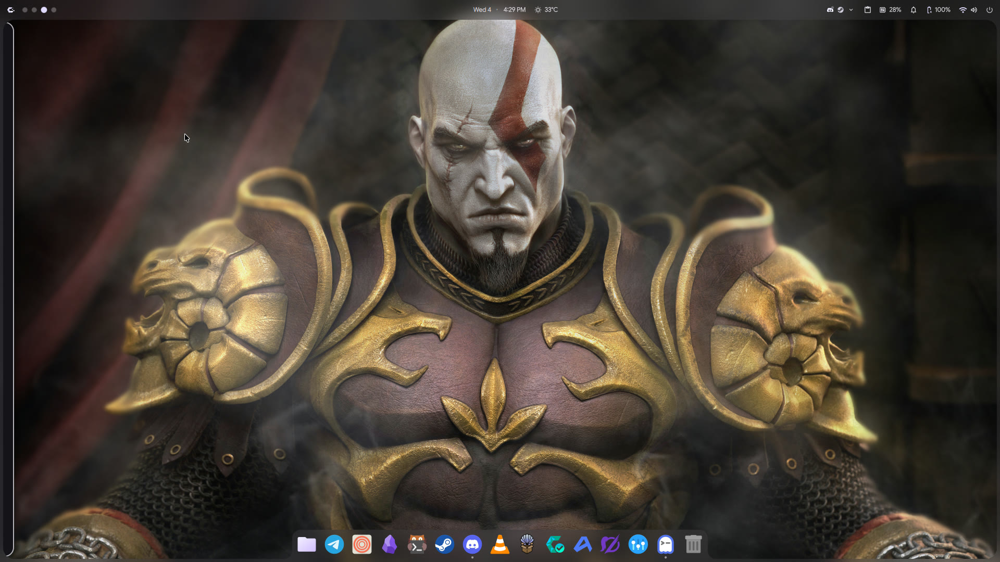
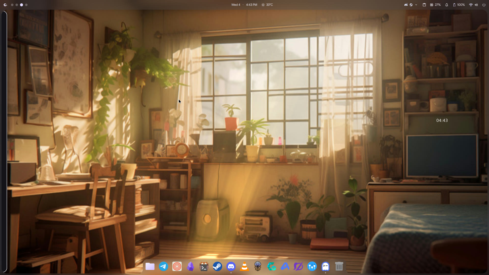
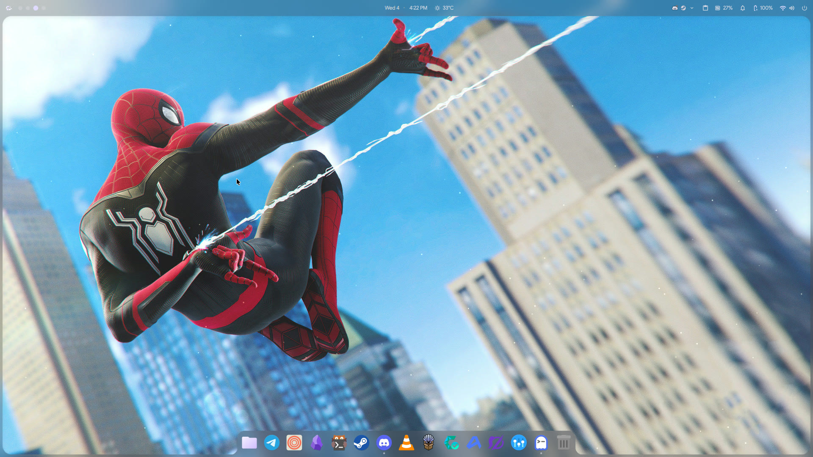
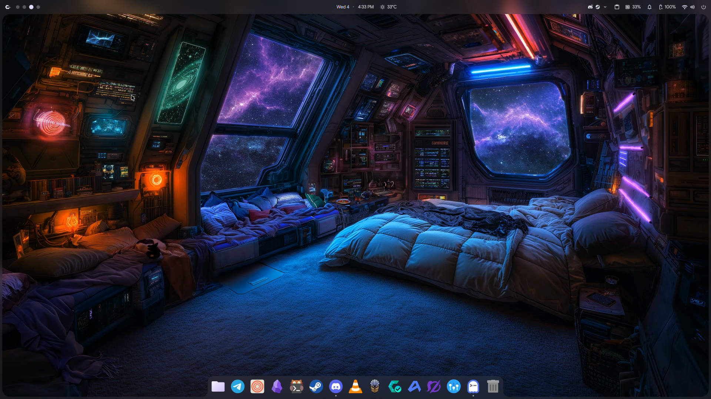

<div align="center">

# 🌟 we-hypr

### *The intelligent, zero-overhead Wallpaper Engine manager for Hyprland.*

Bring your Steam Workshop wallpapers to native Wayland with automatic window-freeze and battery power-saving.

[](https://hyprland.org)
[](https://opensource.org/licenses/MIT)
[](https://store.steampowered.com/app/431960/Wallpaper_Engine/)
[](https://kernel.org)

<br/>


</div>

---

## ⚡ Why we-hypr?

Running Wallpaper Engine through Steam Proton on Wayland creates invisible, broken XWayland windows and cannot render to your desktop. 

**`we-hypr`** connects **`linux-wallpaperengine`** directly to Hyprland's native layer-shell and event bus (`socket2.sock`) with zero-overhead intelligence:

* 🪟 **Auto-Pause on Windows (0% CPU/GPU)**: Whenever any window is open or focused on your active workspace, `we-hypr` immediately freezes the wallpaper on its current frame like a static image. When you switch to an empty workspace or clear the desktop, smooth animation resumes instantly.
* 🔋 **Auto-Pause on Battery Power**: Listens to UPower D-Bus events with zero latency. The instant your charger is unplugged, the wallpaper freezes to conserve battery. When plugged back in, animation resumes automatically.
* 🎮 **Fullscreen Game Detection**: Halts all rendering and audio when any game or video enters fullscreen mode.
* 🎯 **Universal Launcher Integration**: Detects and integrates seamlessly with whatever picker you use: **Rofi**, **Wofi**, **Fuzzel**, **Dux Shell (DMS)**, **Tofi**, or **Bemenu**.
* ⚙️ **GPU Hardware Video Decoding**: Defaults to 30 FPS and GPU hardware decoding (`--hwdec auto` via NVDEC/VCN) to prevent CPU heating and keep 144Hz compositor animations buttery smooth.

---

## 📸 Screenshots

<div align="center">

| God of War (5K Scene) | Cozy Room (Interactive Live Clock) |
| :---: | :---: |
|  |  |

| Spider-Man (3D Particle Scene) | Cyberpunk Space Room (4K Video) |
| :---: | :---: |
|  |  |

</div>

---

## 📦 Requirements

1. **Wallpaper Engine**: Installed in Steam with your favorite workshop wallpapers subscribed and downloaded.
2. **linux-wallpaperengine**:
   ```bash
   # Arch Linux / CachyOS / Manjaro:
   yay -S linux-wallpaperengine-git
   ```
3. **Core Dependencies**:
   ```bash
   # Arch Linux / CachyOS:
   sudo pacman -S python-dbus python-gobject upower libnotify
   ```

---

## 🚀 Quick Install

Clone and run the automated installer:

```bash
git clone https://github.com/DrVivekLinux/we-hypr.git
cd we-hypr
./install.sh
```

The installer:
* Copies `we-hypr` and `hypr-we` into `~/.local/bin/`.
* Installs the `.desktop` launcher for your application menu.
* Enables the systemd background services (`wallpaper-engine.service` and `wallpaper-battery-saver.service`).

---

## 🎮 Usage

### 1. Interactive Wallpaper Picker (GUI)
Press your launcher shortcut (e.g. <kbd>Super</kbd> + <kbd>Space</kbd>) and search for **Wallpaper Engine Picker**, or run:
```bash
we-hypr
```
*Automatically opens in Rofi, Wofi, Fuzzel, DMS, Tofi, or Bemenu depending on what you have installed.*

### 2. Command Line Controls
```bash
# List all downloaded Steam Workshop wallpapers
we-hypr list

# Apply by name (fuzzy search) or Workshop ID
we-hypr set "Cozy Room"
we-hypr set "Spider-Man"
we-hypr set 2607041305

# Check current status, power source, and active auto-pause reason
we-hypr status

# Freeze / resume wallpaper animation manually
we-hypr pause
we-hypr resume
we-hypr toggle-pause

# Custom FPS or audio settings
we-hypr set "Spider-Man" --fps 60 --volume 20
```

---

## ⌨️ Hyprland Keybinds (Optional)

Add this to your `~/.config/hypr/hyprland.conf` to toggle or pick wallpapers anytime:

```ini
# Open Wallpaper Engine picker
bind = $mainMod, W, exec, we-hypr pick

# Freeze/unfreeze wallpaper manually
bind = $mainMod SHIFT, W, exec, we-hypr toggle-pause
```

*(For Lua configurations like Dux Shell, bind `we-hypr pick` to your desired key).*

---

## 🔋 Power Saving Matrix

| Scenario | Behavior | CPU / GPU Overhead |
|:---|:---:|:---:|
| **Clean Desktop (on AC power)** | 🟢 Full 30 FPS Live Animation | ~1–2% CPU |
| **Window Open / Focused** | ⏸️ **Instant Freeze on Last Frame** | **0.0% CPU / 0% GPU** |
| **Fullscreen Game / App** | ⏸️ **Instant Freeze / Muted** | **0.0% CPU / 0% GPU** |
| **On Battery (Unplugged)** | ⏸️ **Instant Freeze / Static Frame** | **0.0% CPU / 0% GPU** |

---

## 🗑️ Uninstallation

```bash
cd ~/we-hypr
./uninstall.sh
```

---

## 🤝 Contributing

Contributions, feature requests, and PRs are welcome! Feel free to star ⭐ the repository if you found it useful.

## 📄 License

Distributed under the [MIT License](LICENSE).
